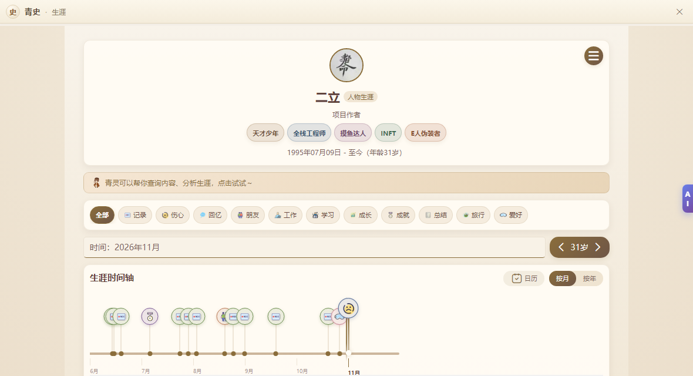
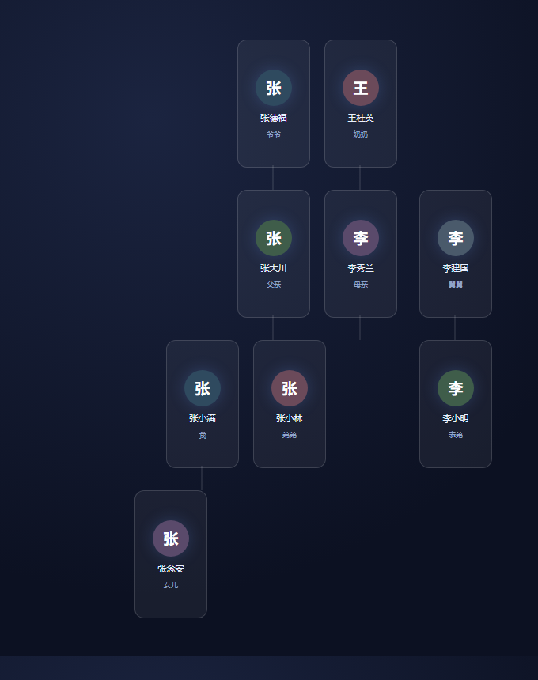

# dsh-qingshi · 让 AI 知道你的故事

把「青史永存」小程序当作存放你故事的地方。装上这个插件后，Harness 里的 AI 能读到你的生涯记录和族谱，
知道你是谁、今年多大、去过哪里、家里人怎么称呼——你说「记一笔」，它还能把话变成一条真正的记录。

它不是把数据导出成文件喂给 AI，而是**现场查你的青史账号**：问什么查什么，答案永远最新，
你在小程序里改过的东西，它也看得到最新的。

这个包同时是一个 **MCP server**——除了 DSH，Codex、Claude Code、Cursor 也能接上它（见下方「在别的 AI 里用」）。



---

## 它能做什么

| 你会这样问 | 它做什么 |
| --- | --- |
| 你知道我是谁吗？我今年多大？ | 读账号资料（昵称、性别、生日、标签），算出年龄 |
| 我去过哪些地方？2024 年我在做什么？ | 按年份、月份、标签、地点、关键词查生涯记录 |
| 我表侄子是谁？我爷爷叫什么？ | 按称谓倒推关系链，沿族谱一层层找人；找不到会说清断在哪一层 |
| 把 2024 年那趟九寨沟调出来 | 打开那条记录的详情页给你看 |
| 帮我记一笔：今天带女儿去了青龙峡 | 打开发布页并把内容填好，**最后一步由你点发布** |
| 把族谱展开，按小家庭排整齐 | 在真实族谱页面上点菜单展开、重排卡片位置，不改任何关系 |

族谱是画布，数据不在接口里，所以这一类操作会开一个真实窗口去点：



> 族谱图是示意，名字是假的。

---

## 安装

目前**没有发布到 npm**，用 tarball 装：

```sh
# 方式一：直接给插件管理器一个地址
dsh plugin add https://github.com/qq1003240666/dsh-qingshi-plugin/releases/latest/download/dsh-qingshi.tgz

# 方式二：下载 dsh-qingshi.tgz 后给本地路径
dsh plugin add ./dsh-qingshi.tgz
```

界面上也可以：**设置 → 插件管理器 → 安装**，粘贴上面的地址或本地文件路径。

装完**完全退出 Harness（包括托盘图标）再打开**，插件只在启动时加载。

---

## 在别的 AI 里用（MCP）

同一个包也是标准 MCP server，29 个工具原样暴露。装好之后让客户端用 stdio 拉起它：

```sh
node /绝对路径/dsh-qingshi-plugin/bin/qingshi-mcp.mjs
```

三个常见客户端的写法：

```sh
# Claude Code
claude mcp add --transport stdio qingshi -- node /绝对路径/dsh-qingshi-plugin/bin/qingshi-mcp.mjs

# Codex CLI
codex mcp add qingshi --command node --args /绝对路径/dsh-qingshi-plugin/bin/qingshi-mcp.mjs
```

```json
// Cursor ~/.cursor/mcp.json、Cline 设置里的 mcpServers 也是这个形状
{
  "mcpServers": {
    "qingshi": { "command": "node", "args": ["/绝对路径/dsh-qingshi-plugin/bin/qingshi-mcp.mjs"] }
  }
}
```

不需要额外依赖。详细的环境变量、工具分组、排错见 [docs/MCP.md](docs/MCP.md)。

---

## 前置条件

| 条件 | 说明 |
| --- | --- |
| 一个青史账号 | 先在微信小程序「**青史永存**」里注册，并**绑定手机号**；插件就是用这个手机号登录 |
| Node.js >= 22.4 | Harness 本身的运行环境 |
| Electron（可选） | 想用无边框桌面窗口就需要，`cd shell && npm install` 装一次；不装会自动退回系统 Chrome/Edge 的窗口 |
| Windows | 主开发和验证平台。macOS / Linux 理论上能跑，但没有实测 |

---

## 注意事项

- **发布权在你手里。** 插件不会替你点「发布」。它最多把页面打开、内容填好，最后一步你自己确认。
- **新记录默认「所有人可见」。** 需要仅自己可见时直接说一声，插件会改成私有，或创建时就带上这个设置。
- **登录凭证只存在本机。** `~/.dsh/qingshi-workspace/auth.json`，权限 0600；不进对话、不进日志。
- **只连你自己配置的地址。** 默认 `api.iyouwc.cn` 与 `qingshi.iyouwc.cn`，不会发到别处。
- **不会编造。** 查不到就说查不到，不会为了好听给你编一段经历。
- **不改你的数据。** 除了你明确要求的记录增改，插件不会动族谱关系、不会改根节点。
- **暂未上架 npm**，所以 `dsh plugin add dsh-qingshi` 这条短命令目前用不了，请用上面的 tarball 地址。

---

## 遇到问题

| 现象 | 怎么办 |
| --- | --- |
| 提示没登录 / 登录过期 | 让它打开青史，会弹出一个小登录窗，用小程序绑定的手机号登一次即可，之后不用重复登 |
| 窗口打不开 | 装 Electron（`cd shell && npm install`），或把 `windowMode` 改成 `app` 走系统浏览器 |
| 改了代码没生效 | 插件只在 Harness 启动时加载，完全退出再打开 |

详细的实现说明、工具清单与配置项见 [`docs/MAINTAINER-NOTES.md`](docs/MAINTAINER-NOTES.md)（面向改代码的人）。

---

## 链接

- 青史 H5：<https://qingshi.iyouwc.cn>
- 发布记录：[CHANGELOG.md](CHANGELOG.md)
- 许可证：[MIT](LICENSE)
