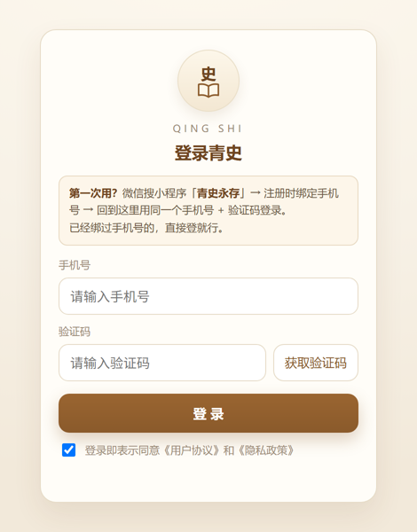

# dsh-qingshi —— 青史 × DeepSeek Harness 插件

## 这个插件解决什么问题

[「青史永存」](https://qingshi.iyouwc.cn) 是一个记录自己故事、也为家人记故事的小程序，顺带带着族谱。
但它是个封闭的小程序：你的故事就躺在里面，只有你自己翻得动。

装上这个插件，Harness 里的 AI 就接上了这些数据——它知道你是谁、今年多大、去过哪些地方、
你爷爷叫什么、你表侄子是谁；你说「记一笔」，它能把这几句话变成一条真正的生涯记录。

关键在于：**不是把你的数据导出成文件喂给 AI，而是现场查你自己的青史账号**。
问什么查什么，答案永远是最新的；写进去的东西回到小程序里也看得见。


### 装上之后，可以直接这样问

| 你说 | 插件做什么 |
| --- | --- |
| 你知道我是谁吗？我今年多大？ | 读账号资料：昵称、性别、生日、标签、简介，算出年龄 |
| 我去过哪些地方？2024 年我在做什么？ | 查生涯记录，按年份/月/标签/地点筛，给列表或汇总 |
| 我表侄子是谁？我爷爷叫什么？我外婆还在吗？ | 从称谓倒推关系链（妈妈 → 兄弟姐妹 → 他们的孩子 → 再下一代），沿族谱一层层走；走不通会说清断在哪一层 |
| 把 2024 年那趟九寨沟调出来给我看 | 打开那条记录的详情页，不是念一遍文本 |
| 帮我记一笔：今天带女儿去了青龙峡 | 先落本地草稿，或打开发布页预填好内容，**你自己点发布** |
| 把族谱展开，按小家庭排整齐 | 在真实族谱页面上点菜单展开、按小家庭重排位置（不改任何关系、不改根节点） |

### 想记的东西，默认不会自己跑上去

这是刻意的设计：AI 可以帮你整理，但**发布权在你手里**。

- 写记录 = 打开发布页、把标题正文填好，最后一步永远是你点「发布」
- 记录默认可见性「所有人可见」，需要改成「仅自己可见」时插件会提醒，也提供 `privacy` 参数
- token 只存在本机 `~/.dsh/qingshi-workspace/auth.json`（权限 0600），不经过对话、不写进日志
- 除了你自己配置的 `apiBaseUrl` / `webBaseUrl`，不发任何请求到别处

<details>
<summary><b>它是怎么做到的（三步）</b></summary>

1. **登录一次**：插件自带一个本地登录窗（不是网页跳转），用小程序里绑定的手机号登录，两个 token 落到本机。
   
2. **读写都走青史自己的接口**：复刻小程序端的 `httpRequest`（`Authorization: Bearer` + 401 自动用 refresh_token 续期），
   不爬页面、不模拟点击。
3. **页面类操作走真窗口**：需要「看页面」「点菜单」时，插件开一个无边框窗口加载 `qingshi.iyouwc.cn`，
   用 CDP 读页面、点按钮、输入、截图。

族谱页属于第三类——它是画布，数据不在接口里：


> 上图是示意图（名字是假的）。真实族谱里每个节点还有头像、生卒日期、与你相差几代。

</details>

### 它不是什么

- 不是日记生成器：不会编故事，查不到就说查不到
- 不是爬虫：所有读写都走青史官方接口和你自己的账号
- 不会替你点发布、不会替你改族谱关系
- 不是跨平台的：主开发和验证只做了 Windows（macOS/Linux 理论上能跑，未实测）


---

## English

### What it is for

**Qingshi (青史)** is a mini program where you keep your own life stories and your family's, with a family tree
attached. It is closed: your stories sit inside it and only you can scroll through them.

Install this plugin and the AI in Harness is wired to that account — it knows who you are, how old you are,
where you have been, what your grandfather is called and who your cousin's children are. Say "note this down"
and it turns the sentence into a real career record.

The important part: it does **not** export your data into a file for the AI to read.
It queries your live Qingshi account, so answers are always current and anything written shows up in the mini program too.


| You say | The plugin does |
| --- | --- |
| Who am I? How old am I? | reads the account profile (nickname, gender, birthday, tags) and computes age |
| Where have I been? What was I doing in 2024? | searches career records by year / month / tag / location |
| Who is my 表侄 (cousin's grandchild)? What is my grandfather's name? | walks the family tree from a kinship term; says exactly which generation broke when it cannot find someone |
| Show me that Jiuzhaigou trip from 2024 | opens the real detail page instead of re-printing the text |
| Note this down: took my daughter to Qinglong Gorge today | drafts it locally, or opens the add-event page prefilled — **you** press publish |
| Expand the family tree and lay it out by household | clicks the real page's menus and re-layouts the cards (never edits relations or the root node) |

### Writing stays in your hands

AI may help you tidy things up, but publishing is always yours:

- writing a record = opening the publish page with title and body prefilled; the last click is yours
- new records default to "visible to everyone"; the plugin warns you about that and accepts a `privacy` argument
- tokens live only in `~/.dsh/qingshi-workspace/auth.json` (mode 0600), never in the conversation or the logs
- no request goes anywhere except the `apiBaseUrl` / `webBaseUrl` you configure

### How it works

1. **Sign in once** — the plugin opens its own small login window (not a web redirect); you use the phone number already bound in the mini program.
2. **Reads and writes go through Qingshi's own API** — a faithful port of the mini program's `httpRequest` (Bearer token, refresh on 401), no scraping.
3. **Page-level actions use a real window** — for "show me" and "click that menu", it opens a borderless window on `qingshi.iyouwc.cn` and drives it over CDP.

The family tree is page-level, because it is a canvas and its data is not in the API:


> The screenshot above is an illustration with placeholder names.

### What it is not

- not a story generator: it will not invent entries; if a search finds nothing it says so
- not a scraper: every read and write goes through the official API with your own account
- it never publishes for you and never edits family relations
- Windows is the only tested platform

### Tools

It registers 29 tools so a Harness agent can:

- read and write career records (list, detail, add, edit, delete, restore, privacy setting);
- resolve relatives by kinship term (表侄, 舅舅, 外婆 …) by walking the family tree;
- open the real Qingshi H5 pages in a desktop window and drive them (read / goto / click / type / tap / screenshot);
- sign in with the phone number that already has a Qingshi account, and keep both tokens in a local workspace;
- prepare an "add event" page with prefilled content and let the user press publish.

**Install** (not published to npm yet — use the tarball)

```sh
dsh plugin add https://github.com/qq1003240666/dsh-qingshi-plugin/releases/download/v0.15.1/dsh-qingshi.tgz
```

Then fully quit and reopen Harness.

**Requirements**

- A Qingshi account. Register in the WeChat mini program 「青史永存」 and bind a phone number first — the plugin signs in with that number.
- Node.js >= 22.4.
- Windows is the only tested platform: the borderless window, CDP driving and the default-browser fallback are win32 branches. macOS / Linux should run but are unverified.
- Electron is **not** bundled (200MB+). Run `cd shell && npm install` once, or point `QINGSHI_ELECTRON` at any Electron binary; alternatively set `windowMode` to `app` or `kiosk` to use Chrome instead.

**Tokens** are stored in `<workspace>/auth.json` (mode 0600) plus the window profile's localStorage. Nothing is sent anywhere except the Qingshi API endpoints you configure (`apiBaseUrl`, `webBaseUrl`).

## 中文

> 版本变化见 [CHANGELOG.md](CHANGELOG.md)。

让 Harness 里的对话能**直接操作青史这个应用本身**：打开 `qingshi.iyouwc.cn` 的独立窗口、
读页面、点按、输入、截图，顺带用青史自己的接口做可靠读写。

**范围（0.8.0 起）**：只操作 `qingshi.iyouwc.cn` 这一个站点。
早期版本自带的那张「本地固定页面」（`127.0.0.1` 上的登录卡片 + 草稿编辑器 + 自定义时间轴 + 地图弹窗）
**已全部移除** —— 那些界面青史 H5 本来就有，插件不再重复造一遍。

这个插件**不改青史的任何代码**：登录用青史现成的短信登录，读写用现成的
`/get_career_list`、`/add_event`，跟小程序端打的是同一套接口。

---

## 三步结构

### 第 1 步：打开真 H5 窗口

`qingshi_login` / `qingshi_open_h5` 打开的是**青史真的网页版**：
`https://qingshi.iyouwc.cn/#/pages/...`，用 Chrome/Edge 的 `--app` 模式启动，
所以是**独立窗口**（没有地址栏），不是浏览器标签页。

- 浏览器 profile 固定在 `<workspaceDir>/browser-profile`，登录一次就记住了
- `qingshi_login` 会顺带把页面 `localStorage` 里的 `access_token` / `refresh_token`
  **同步进本地工作区**，之后 API 工具（查询 / 记录 / 发布）也能用
- 页面会自动发「体验用户」账号（uid `100000000000000000`）。
  插件**拒绝**用体验用户的 token 覆盖你的真凭证，只提示「在那个窗口里登一次」

`qingshi_ui_*` 这组工具负责操作这个窗口：导航、读页面、按文字点按钮、填输入框、截图。
输入时会派发 `input` + `change`，uni-app 的 `v-model` 靠这两个事件才认。

#### 窗口形态：`windowMode` + `windowSize`

| 值 | 长什么样 | 尺寸 |
| --- | --- | --- |
| `electron`（默认） | 插件自带桌面外壳：无边框窗口 + 自绘奶油色标题栏（左「史 · 青史 · 当前页」，右只有一个 **✕**） | 固定 `windowSize`，默认 `1180x880`，可拖动标题栏、可拉边缩放 |
| `app` | Chrome 应用窗口，带系统标题栏（最小化 / 最大化 / 关闭） | 固定 `windowSize`，由 CDP `Browser.setWindowBounds` 钉死（复用旧窗口也生效） |
| `kiosk` | Chrome 无边框全屏，页面顶部注入标题条，右只有一个 ✕ | 全屏，**不能**指定尺寸 |

`electron` 模式跑的是 `shell/` 里那个极小的 Electron app（`main.js` 40 行 + `preload.js` 画标题栏）：

- 窗口 `frame: false`、`maximizable: false`、`fullscreenable: false`，只留关闭；
- 标题栏 40px，`-webkit-app-region: drag`（所以整条能拖），右侧 ✕ 走 IPC `shell:close`；
- 页面标题通过 `MutationObserver` 跟随 `<title>`，标题栏里显示「生涯 / 族谱 / 个人中心」；
- 外链一律 `shell.openExternal`，不在窗口里跳走；
- profile 在 `<workspaceDir>/electron-profile/`，登录态、CDP 端口（`DevToolsActivePort`）都在里面。

需要 Electron 运行时（约 200MB，装在 `shell/node_modules`，装插件时用 junction 指过去、不复制）。找不到就自动退回 `app` 模式，不会卡住。本机实测必须带 `--no-sandbox`（否则沙箱初始化被 ACL 拦、进程直接崩）。

为什么 `app` 模式改不了那三个按钮：Chrome 的标题栏是 Chromium 自己绘制的——改 `WS_MINIMIZEBOX`/`WS_MAXIMIZEBOX`（`0x16cf0000`→`0x16cc0000`）、去掉 `WS_CAPTION`（→`0x160f0000`）、强制 1px 重排，按钮都还在；同样脚本对记事本有效，所以不是脚本问题。`--kiosk` 又强制全屏（实测 `SetWindowPos` 改尺寸会被还原成 1920x1200）。要「固定宽高 + 只有一个 ✕」只能是 Electron/Tauri 外壳。

### 第 2 步：工作区（存两个 token）

```
<workspaceDir>/auth.json          # 权限 0600
<workspaceDir>/browser-profile/   # Chrome 登录态（windowMode=app/kiosk 时）
<workspaceDir>/electron-profile/  # Electron 登录态（windowMode=electron 时）
<workspaceDir>/drafts.json        # 本地草稿（可选功能）
<workspaceDir>/shots/             # qingshi_ui_shot 的截图
```

默认 `workspaceDir = $DSH_HOME/qingshi-workspace`（没有 `DSH_HOME` 就落到 `~/.dsh/qingshi-workspace`）。

```json
{
  "uid": "……",
  "accessToken": "……",
  "refreshToken": "……",
  "clientPlatform": "plugin",
  "savedAt": "2026-10-30T02:16:21.706Z"
}
```

写入复刻了小程序端 `setAuthStorage` 的**防御式写入**：只有传了值才覆盖。
所以 `/get_token` 只回 `access_token`、不回 `refresh_token` 时，本地那份 `refreshToken` 不会被冲成空。

### 第 3 步：请求层（复刻 httpRequest）

`lib/request.js` 对着 `青史2/utils/request.js` 逐条复刻：

| 小程序端 | 插件端 |
| --- | --- |
| `DEFAULT_HEADERS` 带 `X-Client-Platform` | 同样带，值默认 `plugin` |
| `buildRequestUrl(api)` = baseUrl + api | 一样 |
| `buildResult(code, message, data = null)` | `lib/result.js` |
| `needAccessToken` 时带 `Authorization: Bearer <at>` | 一样 |
| `code === 401` → `refreshToken()` → 重试一次 | 一样；重试那次关掉 `autoRefreshAccessToken` 防死循环 |
| `refreshToken()` 用 `Bearer <refresh_token>` 打 `POST /get_token` | 一样 |
| `code === 403` → `redirectToLogin` | 返回 403 + 提示重新登录 |

后端按 `uid + client_platform` 存 refresh_token，所以插件用自己的平台值就能和小程序、H5 各占一行，
不会互相顶号。

---

## 工具（29 个）

| 工具 | 作用 |
| --- | --- |
| `qingshi_login` | 打开真 H5 登录页；登录完同步 token；已有有效凭证就直接报已登录 |
| `qingshi_me` | 当前登录的是谁、工作区在哪、能读到多少条记录 |
| `qingshi_pages` | 列出青史 38 个页面（路由 + 标题 + 一句话功能），可按关键词查 |
| `qingshi_open_h5` | 打开 / 复用真 H5 窗口，可指定 route |
| `qingshi_ui_read` | 读当前页：标题、地址、可见文字、可点元素、输入框 |
| `qingshi_ui_goto` | 跳到某个路由 |
| `qingshi_ui_click` | 按文字点按钮（精确 → 包含 → CSS 选择器） |
| `qingshi_ui_type` | 往输入框写字（按 placeholder 或下标） |
| `qingshi_ui_shot` | 截图存到 `<workspaceDir>/shots/` |
| `qingshi_search` | 快速检索，每条只回 300 字摘要 |
| `qingshi_find_experience` | 多维筛选 + 全文 + 统计汇总（见下） |
| `qingshi_record` | 直接调 `/add_event` 写一条（不经过页面，最可靠） |
| `qingshi_draft` | 先记成本地草稿（不碰云端） |
| `qingshi_publish` | 把草稿发布到云端（图片此时才上传） |
| `qingshi_event` | 读单条记录的完整内容（正文全文、时间、标签、地点、图片） |
| `qingshi_edit` | 改已有记录：先读原文档再合并回写，`dryRun=true` 只预览不写 |
| `qingshi_delete` | 删记录：先不带 `confirm` 核对，再带 `confirm=true` 真删，删前存本地快照 |
| `qingshi_restore` | 列出本地快照 / 用 `eventId` 把快照写回云端（新 event_id） |
| `qingshi_family` | 直接读族谱真实关系（向上取祖辈、向下取子女，可带兄弟姐妹） |
| `qingshi_open_event` | 参数：`eventId` | 在窗口里打开某条记录的详情页给用户看 |
| `qingshi_prepare_event` | 参数：`title`、`content`、`startDate`、`endDate`、`isStage`、`eventTag`、`targetUid` | 把内容预填进「添加生涯事件」页面并打开，用户自己点发布 |
| `qingshi_logout` | 清掉本地凭证 |

## 页面地图

`lib/pages-map.js` 收了青史 `pages.json` 里的 38 个页面（10 个主包 + 28 个分包页），
每条是 `路由 / 标题 / 分组 / 一句话功能`。模型不需要猜路由：
`qingshi_pages('族谱')` 就能拿到 `/pages/familytree/familytree`。

## 查找经历（qingshi_find_experience）

参数：`query`、`startYear`、`endYear`、`year`、`month`、`eventTag`、`location`、
`targetUid`、`mode`（`list` / `summary`）、`limit`、`fullContent`。

实现是「一次拉全量 + 本地过滤」：`/get_career_list` 带 `content_preview_limit: 5000` 取回全部，
再按关键词（标题 + 正文 + 地点）、标签、年份范围、地点做筛选。

- `mode=list`：逐条 `[i] 起止日期 标题 (标签 · 阶段事件)` + 地点 + 正文摘要
- `mode=summary`：时间跨度、按年份分布、按标签 TOP6、按地点 TOP6、正文合计字数、最近一条

标签做过归一：线上数据里会出现 `hobby`、`spending`、`savings`、`turning_point` 这些
后端枚举里没有的写法，插件用 `TAG_ALIASES` 把它们折回 24 个标准值再统计。

## 按称谓查亲属（qingshi_kinship）

中文亲戚称呼本质是「从自己出发走几步」。插件把称呼拆成步骤，再沿族谱一层层走：

| 步骤 | 含义 | 例 |
| --- | --- | --- |
| `up` | 往上取父母（gender 1=父系，2=母系） | 父亲 = `up-1`；外婆 = `up-2 → up-2` |
| `sib` | 同辈兄弟姐妹（先取父母层，再排除自己） | 舅舅 = `up-2 → sib-1` |
| `down` | 取子女 | 侄子 = `sib-1 → down-1` |

所以 **表侄 = 妈妈 → 她的兄弟姐妹 → 他们的孩子 → 再下一代**，对应
`[up-2, sib, down, down-1]`。

三个实现细节，都是被真实数据逼出来的：

1. **族谱节点常常没有 `gender`**，所以按称谓筛人（舅舅=男、姨妈=女）前先用 `/get_userinfo` 补齐性别；补不到就**不硬筛掉**，宁可多列几个人。
2. 断了不要回「没找到」。要说明：走到第几步、卡在谁、那一层目前有谁、以及「这一层有 4 位但没有性别对得上『兄弟』的人（可能族谱里性别录错了）」。
3. 记得带年龄（`ageText`），用户问「表侄多大了」不用再查一次。

## 场景路由（写进系统提示词，模型每轮自己判断）

插件往提示词里放了一张「场景 → 怎么做」表，语义照着青史后端 `backend/modules/ai/service.py` 里的
`SYSTEM_PROMPT` 抄，去掉小程序 action 那套，换成插件自己的工具：

| 用户说的话 | 走哪个工具 |
| --- | --- |
| 打开青史 / 去族谱 / 去个人中心 | `qingshi_open_h5`（带 route），未知路由先 `qingshi_pages` |
| 查看生涯记录（近几年、某地、某标签） | `qingshi_find_experience` |
| 总结 / 分析生涯 | `qingshi_find_experience`（`mode=summary` 或取全量）→ 自己归纳 |
| 查看族谱 / 找家人 | `qingshi_family` 直接读关系数据；想看星空图再 `qingshi_open_h5` + `qingshi_ui_shot` |
| 记录自己的故事 / 感悟 | `qingshi_draft` → 用户确认 → `qingshi_publish` |
| 改已有记录 | `qingshi_event` 核对 → `qingshi_edit`（默认先 `dryRun`） |
| 删记录 | `qingshi_delete` 先预览 → 用户确认 → `confirm=true` |
| 找回删掉的 | `qingshi_restore` |
| 在表单页润色 | `qingshi_ui_read` + `qingshi_ui_type` |

同时抄过来的硬规则：查询必须真调工具（不许编造）、时间只认用户明说的（「最近」不换算）、
查到具体事件要给 `event_id`、数据为空要引导去记录、回复口语化不要 markdown。

## 改 / 删 / 还原（两个后端特性决定了插件怎么写）

青史的两个接口有它的脾气，插件必须顺着来：

1. **`/edit_event` 是整条覆盖**（`career/router.py:204` 起用请求体重建
   `title/content/location/start_date/end_date/is_Stage/event_tag/media_list`）。
   所以 `qingshi_edit` 先 `/get_event` 读原文档、只换掉用户要改的字段，
   再把完整字段（含 `media_list`）整体写回——否则只发一个 title 会把正文、地点、图片清空。
   `dryRun=true` 时只算不写，返回「什么变成了什么」。
2. **`/delete_event` 没有回收站**，删了就是真删。所以 `qingshi_delete` 分两步：
   不带 `confirm` 只给核对摘要，带 `confirm=true` 才真删，且删前把整条记录写进
   `<workspaceDir>/trash/<event_id>.json`。`qingshi_restore` 可以把它重新写回云端
   （用 `/add_event` 新建，因此会拿到新的 event_id）。

另外 `title` 和 `start_date` 是后端必填，改完后如果会变空，插件会直接拒绝并说明原因。

## 草稿 vs 云端：什么才算「保存」

这条是插件里最容易被混淆的语义，提示词和工具描述都写死了：

| 动作 | 落在哪 | 算不算保存 |
| --- | --- | --- |
| `qingshi_draft` | 本机 `<workspaceDir>/drafts.json` + `media/` | **不算**，换台机器就没了，不需要登录 |
| `qingshi_publish` | 图片传 OSS → `/add_event` 落库 | **算，永久保存**，发出去后插件撤不回 |
| `qingshi_record` | 跳过草稿直接 `/add_event` | **算，永久保存**（快捷方式） |

所以默认只记草稿，用户说「发出去 / 上传到云端 / 发布第 N 条」才发布；发布前要核对标题正文，不要重复发同一条。

## 本地草稿（可选，不再有界面）

`qingshi_draft` 可以把一条经历先存成本地 `drafts.json`，`qingshi_publish` 再挑着发到云端。
界面已经在 H5 里了，这组工具现在纯做 API 侧：

```
qingshi_draft    → 只写 <workspaceDir>/drafts.json
qingshi_publish  → 要 OSS 签名 → 直传 OSS → confirm → /add_event 带 media_list
```

顺序和青史 `pages/career/sub/eventEdit.vue` 完全一致（`uploadFilesWithOss` → `buildUploadedMediaList` → `/add_event`），
`media_list` 每项只留 `{upload_file_id, url, content_type}`。

## 自动记录（autoRecord）

插件往系统提示词里注册了一段 `qingshi:auto-record`（`order: 900`），三档：

| 值 | 行为 |
| --- | --- |
| `off` | 不主动提议，只在你明确说「记一下」时写 |
| `suggest` | 判断是经历就先问一句，你点头再写（默认） |
| `auto` | 判断是经历就直接记，回复末尾说一句「已存到本地草稿」 |

判定口径写在提示词里：真实发生、属于你或家人、带时间/地点/人物/过程里至少两项；
技术讨论、代码、假设、他人隐私、模型推测都不算。

## 配置（cordis.patch.yml）

| 键 | 默认 | 说明 |
| --- | --- | --- |
| `apiBaseUrl` | `https://api.iyouwc.cn` | 青史后端 |
| `webBaseUrl` | `https://qingshi.iyouwc.cn` | 真 H5 站点 |
| `workspaceDir` | `$DSH_HOME/qingshi-workspace` | token / profile / 草稿 / 截图都在这 |
| `browserProfileDir` | `<workspaceDir>/browser-profile` | Chrome 登录态目录（app / kiosk 模式用） |
| `electronProfileDir` | `<workspaceDir>/electron-profile` | Electron 外壳的 profile（登录态 + CDP 端口） |
| `windowMode` | `electron` | `electron` = 自带无边框外壳，自绘标题栏，只有一个 ✕（推荐）；`app` = Chrome 应用窗口（系统标题栏三个按钮）；`kiosk` = 无边框全屏 + 注入标题条 |
| `windowSize` | `1180x880` | 窗口固定尺寸，形如 `1180x880`（kiosk 不生效） |
| `clientPlatform` | `plugin` | 记在本地 `auth.json` 里的平台名（不发给后端） |
| `requestPlatform` | `plugin` | 打开窗口后给登录请求注入的 `X-Client-Platform`；留空 = 不拦截，后端会记成 `h5` |
| `allowFamilyWrite` | `false` | 代家人写记录，默认关 |
| `autoOpenBrowser` | `true` | 打开窗口时自动弹出来 |
| `autoRecord` | `suggest` | 见上表 |

环境变量 `QINGSHI_BROWSER` 可以指定浏览器路径；设成 `none` 就完全不碰浏览器（自测用）。

## 安装

两种方式，任选一种。

> 本包**暂未发布到 npm**，所以 `dsh plugin add dsh-qingshi` 现在会去注册表里找一个不存在的名字。请用下面 A 或 B。

**A. 从 GitHub Release 的 tarball（推荐）**

下载 [v0.15.1 的 `dsh-qingshi.tgz`](https://github.com/qq1003240666/dsh-qingshi-plugin/releases/download/v0.15.1/dsh-qingshi.tgz)，然后：

```sh
dsh plugin add ./dsh-qingshi.tgz

# 也可以直接把 https 地址交给插件管理器
dsh plugin add https://github.com/qq1003240666/dsh-qingshi-plugin/releases/download/v0.15.1/dsh-qingshi.tgz
```

在 Harness 界面里则是：设置 → 插件管理器 → 安装 → 粘贴上面的 tarball 地址（或本地绝对路径）。

**B. 从源码（改代码时用这个）**

```sh
git clone https://github.com/qq1003240666/dsh-qingshi-plugin.git
cd dsh-qingshi-plugin
node install.mjs            # 装进默认 profile（~/.dsh/profiles/desktop）
```

装完**重启 Harness**（插件只在启动时装载）。

### 桌面窗口需要 Electron

插件默认用自带的 Electron 外壳画窗口（无边框、奶油色标题栏）。Electron 二进制有 200MB+，**不随包分发**，第一次用之前装一次：

```sh
cd shell && npm install
```

或者设 `QINGSHI_ELECTRON` 指向任意 Electron 可执行文件。不想装 Electron 的话，把 `windowMode` 改成 `app`（用 Chrome 应用窗口）或 `kiosk` 也行。

### 前置条件

- 需要青史账号：先在微信小程序里搜「**青史永存**」注册并绑定手机号，插件才能登录。
- macOS / Linux 未经验证（无边框壳与窗口控制目前只做了 Windows 分支）。

装完**重启 Harness**（插件在启动时装载，改文件不会热生效）。

## 安全

- token 只在插件进程和 `<workspaceDir>/auth.json`（0600）之间流动，**不作为工具参数进对话**
- 工具输出里只出现 uid、记录条数、页面文字，不出现 token 原文
- 浏览器只连青史的域名；`/api/avatar` 这类本地代理路由随固定页面一起移除了


## 登录状态保存在哪（为什么换窗口不用重新登）

两个方向都要，缺一个就会出现「刚登完，下次打开又要登」：

| 方向 | 时机 | 代码 |
| --- | --- | --- |
| 窗口 → 本地 | 你在窗口里登录完（或窗口里换了账号） | `syncTokenFromBrowser()` 把 `localStorage` 里的 `access_token` / `refresh_token` / `my_uid` 写进 `<工作区>/auth.json`（0600） |
| 本地 → 窗口 | 每次开窗（`qingshi_open_h5` / `qingshi_login` / 任何要用窗口的工具） | `hydrateBrowserAuth()` 先把 `auth.json` 里的两个 token 注入新窗口的 `localStorage`，再导航到目标页 |

所以：浏览器 profile 被清、换了 `electronProfileDir`、甚至换台机器（只要把 `auth.json` 拷过去），打开窗口都是已登录状态。token 只存在本地文件里，从不进对话。

> 如果你在窗口里点了「退出登录」，`qingshi_logout` 会清掉 `auth.json`；下次开窗就会是未登录。

## 已知限制

- **平台**：只在 Windows 上实测过。无边框窗口、CDP 调试、默认浏览器回退都写着 win32 分支；macOS / Linux 能跑但没验。
- **Electron 不随包分发**：首次使用前需要 `cd shell && npm install`（或设 `QINGSHI_ELECTRON`）。

- `oss.iyouwc.cn` 的 TLS 证书过期了（浏览器里头像/图片会失败），需要用户续证书
- `/add_event` 没有幂等键：同一条别连发两次
- `flag` 这个标签不在 24 个标准枚举里，页面会直接显示英文
- 页面里点按靠文字匹配，浮动菜单（比如族谱节点的右键菜单）可能点不中；
  读数据走接口更稳
- 浏览器自动化依赖本机装了 Chrome / Edge

## 自测

```bash
cd E:/Desktop/deepseekHarness
rm -rf .tmp/qingshi-test2/plugin && cp -r plugins/dsh-qingshi .tmp/qingshi-test2/plugin
node .tmp/qingshi-test2/run.mjs      # 153 passed, 0 failed
```

测试用假的 `fetch` 桩（`/get_career_list`、`/add_event`、OSS 三段等），
外加 `QINGSHI_BROWSER=none` 验证「没有浏览器时也不崩」。

## 登录方式（0.14.0 起：插件自带登录页）

`qingshi_login` 不再把青史网页版的登录页塞给用户，而是：

1. 插件在 `127.0.0.1:<随机端口>` 起一个自己的登录页（`lib/login-page.js` + `lib/login-server.js`）；
2. 页面里的「获取验证码 / 登录」请求打到插件本地服务，由插件带 `X-Client-Platform: plugin` 转到青史后端 `/login/sms_send`、`/login/sms_login`；
3. 登录成功立刻把两个 token 写进工作区 `auth.json`，并把登录态注入青史窗口 —— **用户不需要回对话里再点「我已登录」**。

凭证还有效时 `qingshi_login` 直接报已登录；要换账号传 `force: true`。

> 注意：`client_platform` 想真正落库成 `plugin`，后端必须部署支持 `X-Client-Platform` 的版本（仓库里那两处未提交改动）；否则旧后端仍会写 `h5`。

## 窗口生命周期

插件启动的 Electron 外壳会拿到 `QINGSHI_PARENT_PID`，`shell/main.js` 每 2 秒探一次父进程，Harness 退出后窗�口自己关掉，不会留下孤儿进程。
