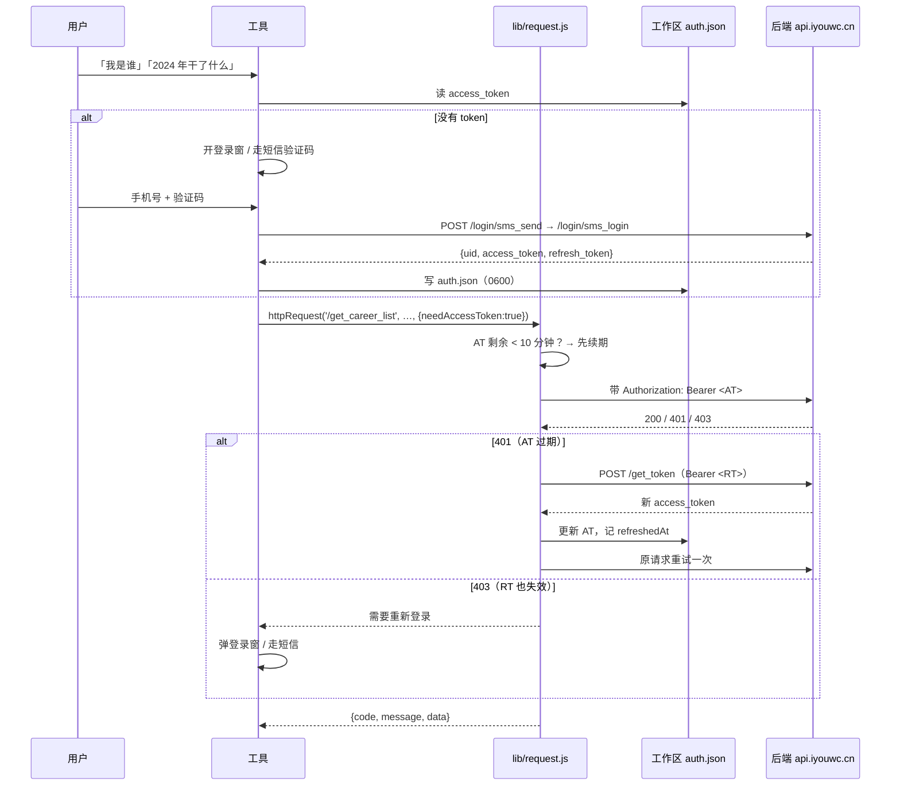

# 登录与请求：一条完整的链路

这份文档回答两个问题：**token 从哪来、存在哪**，以及**每个请求都经过了什么**。
下面每一步都能在代码里找到对应行，命名尽量跟青史小程序端保持一致，方便两边对照着改。

## 0. 先看全景



## 1. 登录：三条路，一套结果

| 场景 | 怎么走 | 代码 |
| --- | --- | --- |
| DSH / 有桌面的机器 | 插件开一个 470×640 的登录小窗（自己的页面，不是青史 H5），在里面输手机号 + 验证码 | `openLoginWindowAndWait()` |
| MCP / 服务器 / 无窗口 | 工具说「这台机器没有可用的窗口」，先要手机号 → `qingshi_login({phone})` 发码 → `qingshi_login({code})` 完成 | `qingshi_login` 的 phone/code 分支 |
| 用户已经在青史窗口里登过 | 从那个窗口的 localStorage 把 token 抄回来 | `syncTokenFromBrowser()` |

三条路的终点完全一样：**`<数据目录>/auth.json`**，字段固定：

```json
{
  "uid": "117788298679078280",
  "accessToken": "eyJhbGciOi…",
  "refreshToken": "DzDjerUu…",
  "clientPlatform": "plugin",
  "savedAt": "2026-11-05T07:00:00.000Z",
  "refreshedAt": "",
  "refreshExpiresAt": ""
}
```

`accessToken` 是 JWT（HS256，**2 小时**），`refreshToken` 是 32 字节随机串（**7 天**，每次续期顺延）。
文件权限 0600；token 不会出现在任何工具输出里，也不进对话。

## 2. 每次调用工具之前：先验一次，别装作已登录

`ensureLoggedIn()` 的顺序：

1. 还开着的青史窗口能给 token 吗？能给就抄下来（`syncTokenFromBrowser`）。
2. 本地有 token 吗？没有 → 走登录（按上表选路）。
3. **真打一次后端**（`/get_career_list` 只取 1 条），而不是只看文件存在：
   - `200` → 好，继续；
   - `401 / 403` → 凭证已死 → 走登录。**注意不清空本地凭证**，避免把还能用的 RT 提前删掉。

这一步是修掉「明明登录了还一直让我登录」的关键：本地有 token ≠ 服务端还认。

## 3. 请求层：和 `utils/request.js` 一一对应

`lib/request.js` 是那份文件的 Node 版本，语义照抄，只把 `uni.request` 换成 `fetch` + `AbortController`：

| 小程序端 | 插件里 | 说明 |
| --- | --- | --- |
| `DEFAULT_HEADERS = {Content-Type, X-Client-Platform}` | 同名 | 平台标识**每个请求都带**，包括登录和续期 |
| `normalizeRequestOptions()` | 同名 | `needAccessToken` 默认 **true**；支持 `needToken` / `autoRefresh` 别名；`showErrorToast`、`showServerErrorMessage` 保留为参数（插件里无 toast，只记日志） |
| `buildRequestUrl(api)` | 同名 | `apiBaseUrl + api` |
| `buildResult(code, message, data)` | `lib/result.js` | 统一返回形状 |
| `refreshToken()` | 同名 | `POST /get_token`，`Authorization: Bearer <RT>`；后端只回新 AT，不回 RT |
| `httpRequest(api, data, options)` | 同名 | 401 → 续期 → 重试一次（重试时关掉自动续期，防死循环） |
| `403` | 同名 | RT 失效 → 返回「需要重新登录」，由上层弹窗 |
| `getCurrentUid()` / `clearAuthStorage()` | 同名 | 读 uid / 清凭证（退出登录用） |

在它之上加了三件小程序端不需要、但长期运行必须要的东西：

1. **提前续期**：AT 剩余不足 10 分钟就先换新的，避免「正好卡在过期点」白吃一次 401。
2. **RT 保活**：超过 5 天没续过，就静默喂一次 `/get_token`——后端每次会给 RT 续 7 天，不喂就会自然过期。
3. **续期失败去窗口捞一次**：多个窗口/多个客户端同时登录时，`refresh_tokens` 按 `(uid, client_platform)` 只有一行，
   谁最后登录谁的 RT 生效。别的窗口可能刚续过，所以 401/403 时先问窗口要一次新 token 再决定要不要用户重登。

## 4. 一次业务请求的完整时序

```
读 auth.json → AT 快到期？→ 续期 → 带 Authorization 发请求
   → 200：返回 body（青史有的接口把业务字段放顶层，如 career_list / event_list，这里原样透传）
   → 401：续期 → 成功则重试一次；失败则向上要登录
   → 403：向上要登录
   → 非 200 HTTP：返回 code=statusCode
   → 超时/网络错误：code=500，message 带「请求超时（15000ms）」这类原因
```

`authed()` 是 `httpRequest` 的薄包装（固定 `needAccessToken: true`），业务代码只用它，
免得每次都手写头。另外它在 401/403 时会做一次「凭证快照比对 + 等 1.2 秒再比」的重试，
专门对付「另一个会话刚好把 token 续掉了」的竞态。

## 5. 其他从 `utils/` 搬过来的东西

| 原文件 | 插件里 | 搬了什么 |
| --- | --- | --- |
| `utils/platform.js` | `lib/format.js` 的 `detectClientPlatform()` | 平台判定；插件默认 `'plugin'`，可用 `QINGSHI_REQUEST_PLATFORM` 覆盖 |
| `utils/format.js` | `lib/format.js` | `formatDate` / `formatDateTime` / `formatFileSize` 三个纯函数 |
| `utils/upload.js` | `lib/upload.js` | OSS 三段式：`/get_oss_upload_signature` → multipart 直传 → `/confirm_oss_upload`，字段与小程序一致 |
| `utils/userCache.js` | `lib/users.js` | 按 uid 缓存资料、带过期时间、读不到就回落旧值 |
| `utils/logger.js` | `logger` 回调 | 不写文件，统一走宿主日志（DSH 控制台 / MCP stderr） |

没搬的：`avatarCache`、`previewImageCache`、`ttsFileCache`、`tencentRealtimeAsr`——
那些是手机端的图片/语音缓存，插件不渲染列表，用不上。

## 6. 自定义平台标识（可选）

后端 `refresh_tokens` 的唯一键是 `(uid, client_platform)`。如果你希望「每个窗口/每个客户端一条 RT」，
给不同实例设不同的 `QINGSHI_REQUEST_PLATFORM`（例如 `plugin-a` / `plugin-b`），它们就不会互相顶掉。
不设的话都是 `plugin`，同平台重登会覆盖同一行——这也是「A 窗口登完，B 窗口要重登」的根因。
